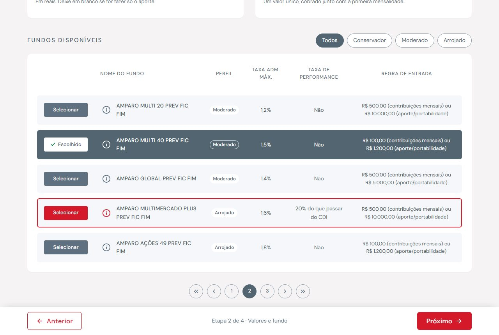
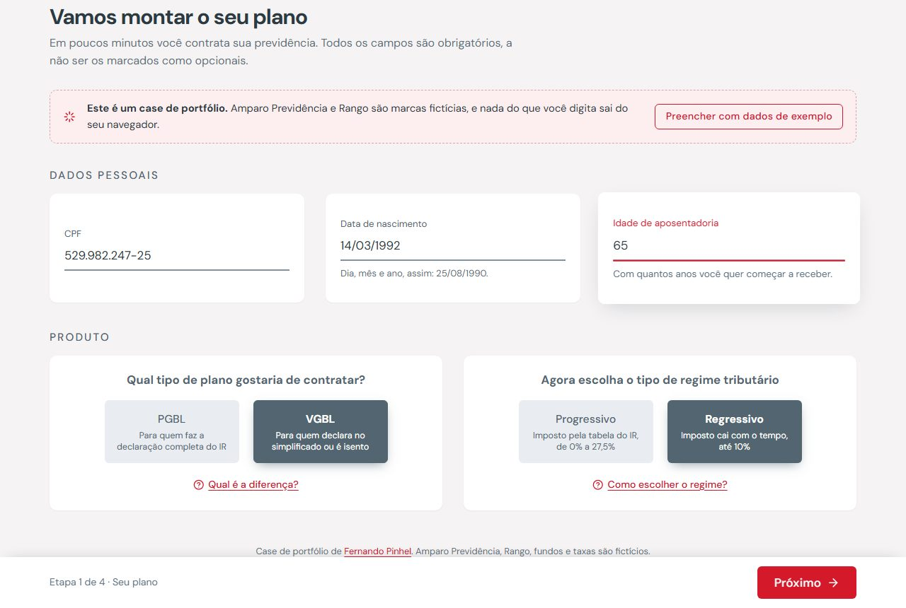
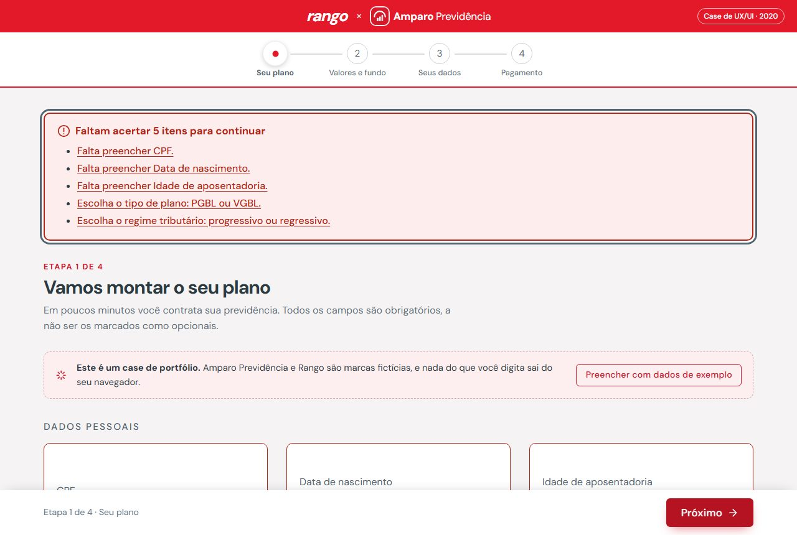
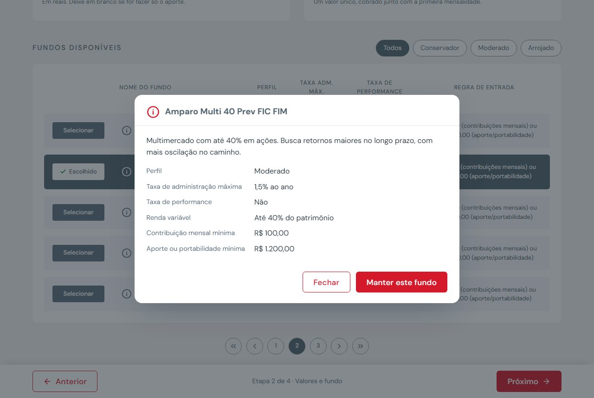
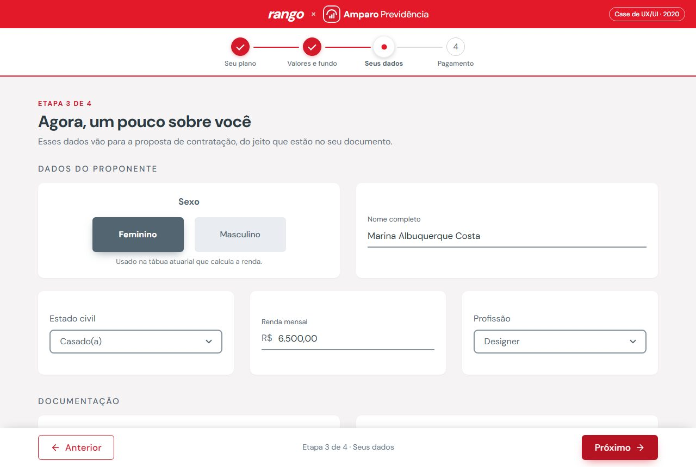
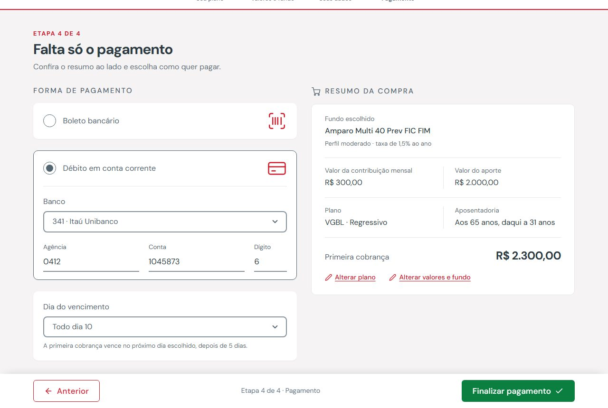
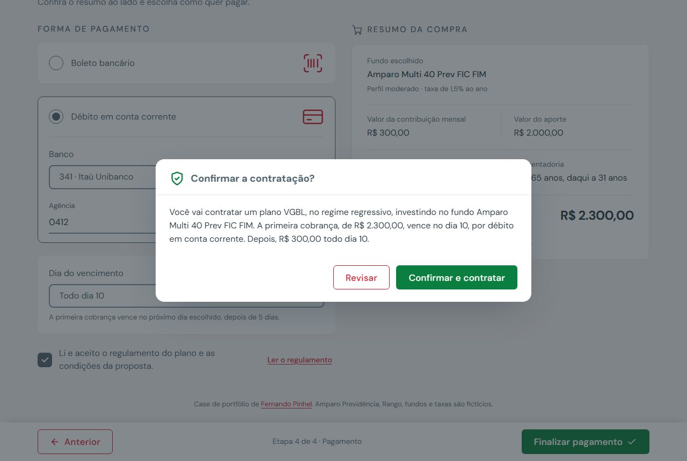
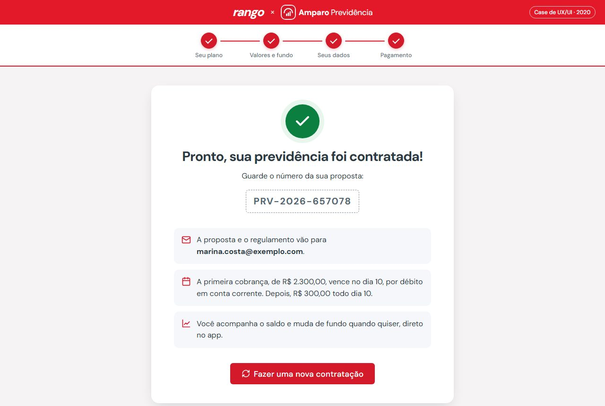
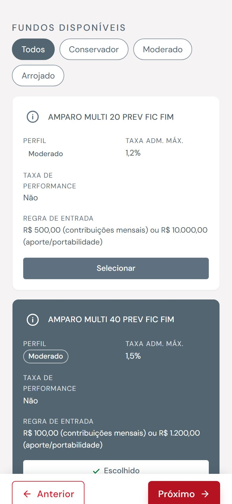

<div align="center">


# Contratação de Previdência

**Case de UX/UI e front-end: contratação de previdência privada em 4 etapas, dentro de um app parceiro.**

[](https://github.com/fernandopinhel/prototipo-mapfre/actions/workflows/ci.yml)


[Ver o protótipo](https://fernandopinhel.github.io/prototipo-mapfre/) ·
[Como rodar](#como-rodar-localmente) ·
[O case](#o-case)



</div>

> **Este é um case de portfólio.** O projeto nasceu em 2020, numa empresa onde trabalhei,
> e foi recriado aqui para mostrar o processo e o resultado. Para preservar a empresa e os
> clientes, a interface usa duas marcas fictícias: a seguradora **Amparo Previdência** e o
> app de delivery **Rango**. Fundos, taxas, nomes e CPFs são de exemplo, e nada do que você
> digita sai do seu navegador.

---

## Sumário

- [O case](#o-case)
  - [Contexto e problema](#contexto-e-problema)
  - [Objetivo](#objetivo)
  - [Decisões de design](#decisões-de-design)
  - [Modernizar sem perder a identidade](#modernizar-sem-perder-a-identidade)
  - [As marcas fictícias](#as-marcas-fictícias)
  - [Revisitando o case](#revisitando-o-case)
- [A jornada, tela a tela](#a-jornada-tela-a-tela)
- [O que funciona no protótipo](#o-que-funciona-no-protótipo)
- [Acessibilidade](#acessibilidade)
- [Tecnologias e arquitetura](#tecnologias-e-arquitetura)
- [Como rodar localmente](#como-rodar-localmente)
- [Publicação no GitHub Pages](#publicação-no-github-pages)
- [Segurança e privacidade](#segurança-e-privacidade)
- [Limitações](#limitações)
- [Próximos passos](#próximos-passos)
- [Histórico](#histórico)
- [Autor](#autor)

---

## O case

### Contexto e problema

Uma seguradora queria vender previdência privada dentro do app de um parceiro, para um
público que nunca tinha contratado um plano. O caminho que existia era o sistema interno de
contratação, feito para corretores: uma tela longa, cheia de selects, com termos técnicos
(PGBL, VGBL, regime tributário, taxa de performance) sem nenhuma explicação, e uma tabela de
fundos em caixa alta, difícil de comparar.

Para quem chegava pelo app, isso significava:

- não entender a diferença entre os tipos de plano e escolher no chute;
- descobrir só no fim que o valor digitado era menor que o mínimo do fundo;
- preencher dezenas de campos sem saber quanto faltava;
- chegar ao pagamento sem ver um resumo do que estava contratando.

### Objetivo

Redesenhar a contratação para o celular e para o desktop, com a cara do app parceiro, em que a
pessoa:

1. monta o plano em **4 etapas curtas**, sabendo sempre onde está;
2. entende cada escolha técnica com **uma explicação a um toque**;
3. compara os fundos com **perfil, taxas e regra de entrada** lado a lado;
4. vê na hora se o valor atende ao **mínimo do fundo escolhido**;
5. confere um **resumo da compra** antes de pagar.

### Decisões de design

| Decisão | Por quê |
| --- | --- |
| **4 etapas com indicador numerado** | Dividir um formulário longo em blocos reduz a sensação de esforço. Os círculos mostram o que já foi feito (visto vermelho), onde a pessoa está (ponto) e o que falta. |
| **Um campo por cartão** | Cada cartão destaca uma pergunta e "salta" quando o campo recebe foco, guiando o olhar pelo formulário. |
| **Rótulo flutuante com sublinhado** | O rótulo ocupa o lugar do placeholder e sobe ao digitar, sem sumir. O sublinhado vermelho que corre da esquerda mostra o campo ativo. |
| **Escolhas em blocos, não em selects** | PGBL ou VGBL, progressivo ou regressivo: são duas opções, então ficam à vista, cada uma com uma frase do que significa. |
| **"Qual é a diferença?" ao lado de cada escolha técnica** | A explicação aparece só para quem precisa, num diálogo curto, sem tirar a pessoa da etapa. |
| **Tabela de fundos com linha escolhida em destaque** | A borda vermelha no hover e a linha inteira em ardósia quando escolhida deixam claro qual fundo está valendo, mesmo ao rolar. |
| **Filtro por perfil** | Conservador, moderado ou arrojado é a forma como as pessoas pensam em risco, mais do que "renda fixa" ou "FIC FIM". |
| **Regra de entrada validada contra o fundo** | Se o fundo pede R$ 500 por mês e a pessoa digitou R$ 300, o aviso aparece no campo do valor, com o mínimo escrito. |
| **Resumo da compra ao lado do pagamento** | Fundo, valores, plano, idade de aposentadoria e o valor da primeira cobrança, com atalhos para alterar. |
| **Rodapé de ações fixo** | "Anterior" e "Próximo" ficam sempre ao alcance do polegar, e o "Finalizar" muda de cor (verde) para marcar o passo final. |

### Modernizar sem perder a identidade

A revisão manteve os elementos que davam personalidade ao protótipo de 2020 e trabalhou o
acabamento em volta deles:

| Elemento original | O que ficou | O que mudou |
| --- | --- | --- |
| Faixa vermelha com as marcas no topo | Mesma faixa e mesmo vermelho | Marcas fictícias e um tom levemente mais escuro, para o branco passar de 4,5:1 |
| Etapas em círculos numerados, com linha e borda vermelha | Mesmo desenho, visto vermelho e ponto da etapa atual | Rótulos com o nome de cada etapa, linha que fica vermelha conforme avança e estados para leitor de tela |
| Fundo cinza-quente e cartões brancos de 154 px | Mesmas cores, mesma altura | Cantos mais arredondados, sombra suave e "salto" mais discreto no foco |
| Títulos de seção em caixa alta espaçada | Iguais | Um título de etapa acima, em tom de conversa |
| Blocos cinza que viram ardósia ao marcar | Iguais | Frase de apoio dentro do bloco e foco visível |
| Tabela com linhas cinza, borda vermelha no hover e "Selecionar" | Iguais, com a linha escolhida em ardósia | Coluna de perfil, filtro, detalhes do fundo e versão em cartões no celular |
| Paginação em círculos | Igual | Funciona de verdade e é anunciada para leitores de tela |
| Rádio redondo do pagamento com ícones de boleto e cartão | Igual | Dados bancários só aparecem no débito em conta |
| Resumo da compra com ícone de carrinho | Igual | Valores reais, total da primeira cobrança e atalhos para alterar |
| Botões "Anterior" (contorno), "Próximo" (vermelho) e "Finalizar" (verde) | Iguais | Ícones, rodapé fixo e contraste revisado |

A fonte também é a mesma, **DM Sans**, agora carregada do Google Fonts no lugar dos 30
arquivos locais.

### As marcas fictícias


**Amparo Previdência** é a seguradora do case. O símbolo é um **arco protegendo três barras
que crescem**: o cuidado de hoje com o futuro, e o patrimônio que aumenta com o tempo. Ele
também é o favicon. **Rango** é o app de delivery parceiro, que empresta o vermelho da faixa
do topo.

<br clear="left">

### Revisitando o case

Em 2026 o protótipo foi revisitado:

- **A identidade visual foi preservada** e o acabamento foi modernizado (veja a tabela acima).
- **Tudo funciona de ponta a ponta**: validação, máscaras, filtro e paginação de fundos, detalhes de cada fundo, resumo ao vivo, confirmação e protocolo.
- **Conteúdo corrigido**: o valor da contribuição usava a máscara de CPF, a segunda seção "Endereço residencial" era, na verdade, de contato, o dia do vencimento usava um calendário, as listas tinham opções "1, 2, 3" e todos os fundos tinham o mesmo nome.
- **Acessibilidade revisada para a WCAG 2.2 AA** e verificada com axe em todos os estados.
- **Zero dependências de runtime**: saíram Bootstrap, jQuery, Popper, jQuery Mask, o datetimepicker com 46 arquivos de idioma, as fontes locais e as capturas do sistema antigo, cerca de 9 MB de arquivos.

---

## A jornada, tela a tela

```
Etapa 1 ──────► Etapa 2 ──────────► Etapa 3 ──────► Etapa 4 ─────► Sucesso
Seu plano      Valores e fundo     Seus dados      Pagamento       (protocolo)
```

| Seu plano | Erros com resumo |
| --- | --- |
|  |  |

| Detalhes do fundo | Seus dados |
| --- | --- |
|  |  |

| Pagamento e resumo | Confirmação |
| --- | --- |
|  |  |

| Sucesso | Celular |
| --- | --- |
|  |  |

| Etapa | O que a pessoa faz |
| --- | --- |
| **1. Seu plano** | CPF, data de nascimento e idade de aposentadoria. Escolhe PGBL ou VGBL e o regime tributário, com explicação de cada um. |
| **2. Valores e fundo** | Contribuição mensal, aporte inicial ou os dois. Filtra os 11 fundos por perfil, abre os detalhes e escolhe um. |
| **3. Seus dados** | Dados do proponente, documento, endereço, celular, outro telefone (opcional) e e-mail com confirmação. |
| **4. Pagamento** | Boleto ou débito em conta, dia do vencimento e aceite do regulamento, com o resumo da compra ao lado. |

---

## O que funciona no protótipo

- **Etapas** com estados *atual*, *concluída* e *não iniciada*. Dá para voltar a qualquer etapa pelo indicador ou pelos atalhos "Alterar" do resumo. Para a frente, só depois de validar.
- **Validação por etapa**, com mensagem no cartão e resumo de erros com links. Depois da primeira tentativa, cada erro some assim que é corrigido.
- **Regras**: CPF com dígitos verificadores, datas que existem no calendário, idade entre 18 e 80 anos, aposentadoria maior que a idade atual, nome e sobrenome, CEP, DDD, celular com 9 dígitos, e-mail e confirmação iguais, agência com 4 números.
- **Valores contra o fundo**: pelo menos um dos dois valores, e cada um acima do mínimo do fundo escolhido. Trocar de fundo revalida na hora.
- **Máscaras** de CPF, data, dinheiro (com R$), CEP e telefone.
- **Fundos**: filtro por perfil, paginação, linha inteira clicável, detalhes em diálogo e "Escolher este fundo" direto do diálogo.
- **Outro telefone** é opcional, mas se um dos três campos for preenchido, os outros passam a ser pedidos.
- **Resumo da compra** atualizado ao vivo, com o total da primeira cobrança.
- **Rascunho**: recarregou a página? O fluxo volta na mesma etapa, com tudo preenchido.
- **Confirmação** em `<dialog>` nativo e **tela de sucesso** com número de proposta.
- **Preencher com dados de exemplo** completa as etapas 1 a 3 para quem quer só conhecer o fluxo.

---

## Acessibilidade

O protótipo segue a **WCAG 2.2 nível AA**. Todas as etapas e estados (erros, diálogos,
sucesso e celular) foram auditados com [axe-core](https://github.com/dequelabs/axe-core),
sem violações.

- **Estrutura**: `lang="pt-BR"`, link "Pular para o conteúdo", landmarks, um `h1` por etapa e títulos em ordem.
- **Etapas**: o indicador é uma lista de botões com `aria-current="step"` e o estado de cada etapa escrito para leitores de tela. Ao trocar de etapa, o foco vai para o título e o título da aba muda ("Etapa 2 de 4: Valores e fundo").
- **Formulários**: rótulo visível em todos os campos (o rótulo flutuante é um `<label>` de verdade), dicas com `aria-describedby`, `autocomplete` e `inputmode` certos para cada campo.
- **Erros**: mensagem no campo (`aria-invalid` + `aria-describedby`) e resumo no topo, que recebe o foco e tem links que levam ao campo.
- **Escolhas**: blocos, filtro e fundos são `input type="radio"` nativos em `fieldset` com `legend`, então funcionam com setas do teclado.
- **Tabela de fundos**: `<table>` com cabeçalhos; cada fundo tem um rádio com nome completo ("Escolher Amparo Multi 40 Prev FIC FIM") e um botão de detalhes com nome próprio.
- **Paginação** com `aria-current="page"`, foco mantido no controle clicado e anúncio do intervalo ("Página 2 de 3: fundos 6 a 10 de 11").
- **Diálogos** com `<dialog>` nativo: prendem o foco, fecham com Esc e devolvem o foco a quem abriu.
- **Anúncios** em `aria-live` para ações sem mudança de página: fundo escolhido, filtro aplicado, dados de exemplo.
- **Visual**: contraste de pelo menos 4,5:1 no texto e 3:1 nas bordas dos campos, foco sempre visível, alvos de toque de 44 px e nenhuma rolagem horizontal a 320 px. O CSS respeita `prefers-reduced-motion` e `forced-colors` (alto contraste do Windows).

---

## Tecnologias e arquitetura

| Camada | Tecnologia | Uso |
| --- | --- | --- |
| Marcação | HTML5 | Uma página, sem build. `<dialog>` nativo. |
| Estilo | CSS3, sem framework | `css/app.css`: tokens, grade de 12 colunas, cartões, etapas, tabela e impressão. |
| Comportamento | JavaScript puro | Utilitários, dados e fluxo em três arquivos, sem jQuery nem Bootstrap. |
| Ícones | Sprite SVG próprio | `img/icons.svg`, ícones de traço que herdam a cor do texto. |
| Tipografia | DM Sans | Google Fonts, pesos 400, 500 e 700, a mesma fonte do original. |
| Qualidade | HTMLHint + GitHub Actions | Valida o HTML e barra scripts e estilos inline. |
| Deploy | GitHub Pages via Actions | Publica a cada push na `master`. |

```
.
├── index.html              # As 4 etapas, a tela de sucesso e os diálogos
├── css/
│   └── app.css             # Design system do protótipo
├── js/
│   ├── common.js           # Sessão (sessionStorage), anúncios, ícones e diálogos
│   ├── dados.js            # Fundos, listas dos selects e dados de exemplo
│   └── contratacao.js      # Etapas, máscaras, validação, fundos, resumo e envio
├── img/                    # Símbolo da marca e sprite de ícones
├── docs/screenshots/       # Capturas usadas neste README
└── .github/
    ├── workflows/ci.yml    # Validação de HTML
    ├── workflows/pages.yml # Deploy no GitHub Pages
    └── dependabot.yml      # Atualização das GitHub Actions
```

**Como o fluxo funciona por dentro.** Cada `<section class="step">` é uma etapa, e cada
campo declara suas regras por atributos (`required`, `data-mask="moeda"`,
`data-validate="cpf"`). Os selects são preenchidos a partir de `js/dados.js`
(`data-opcoes="ufs"`). A tabela de fundos é montada com `createElement` a partir da mesma
lista, e o rascunho fica no `sessionStorage` com a chave `prev:rascunho`.

---

## Como rodar localmente

O projeto é estático: basta servir a pasta com qualquer servidor HTTP. Prefira um servidor
ao `file://`, porque a CSP e o sprite de ícones se comportam de forma diferente com
arquivos locais.

```bash
git clone https://github.com/fernandopinhel/prototipo-mapfre.git
cd prototipo-mapfre

# Opção 1: Python
python3 -m http.server 8080

# Opção 2: Node
npx serve .
```

Depois, acesse <http://localhost:8080> e clique em **Preencher com dados de exemplo**.

Para validar o HTML (o mesmo check do CI):

```bash
npx htmlhint@1 "*.html"
```

---

## Publicação no GitHub Pages

O workflow `.github/workflows/pages.yml` publica o site a cada push na `master`. Para ativar:

1. No GitHub, abra **Settings → Pages**.
2. Em **Build and deployment → Source**, escolha **GitHub Actions**.
3. Faça um push na `master` ou rode o workflow em **Actions → Deploy GitHub Pages**.

O endereço será <https://fernandopinhel.github.io/prototipo-mapfre/>.

---

## Segurança e privacidade

- **Nenhum dado sai do navegador.** Não há back-end. O rascunho fica no `sessionStorage` e some ao fechar a aba ou ao concluir a contratação.
- **Content Security Policy**: `script-src 'self'`, `style-src` sem `'unsafe-inline'`, `object-src 'none'`, `base-uri 'self'` e `form-action 'self'`. Só o Google Fonts é liberado como origem externa.
- **Sem JavaScript nem CSS inline.** O CI barra `<script>` inline, handlers `on*=` e atributos `style=`.
- **Sem injeção de HTML.** A tabela, o resumo e os diálogos são montados com `createElement` e `textContent`, nunca com `innerHTML`.
- **Sem bibliotecas de terceiros no runtime.** O número da proposta usa `crypto.getRandomValues`.
- **Referrer Policy** `strict-origin-when-cross-origin` e `noindex` para buscadores.
- **CI com permissões mínimas** (`contents: read`) e Dependabot para as Actions.

O GitHub Pages não permite definir cabeçalhos HTTP, por isso a CSP vai em `<meta>` e
`frame-ancestors` não se aplica. Veja também o [SECURITY.md](SECURITY.md).

---

## Limitações

- É um **protótipo**: não há back-end, autenticação, consulta de CEP, débito em conta nem emissão de proposta de verdade.
- Fundos, taxas, mínimos e o regulamento são fictícios e não são recomendação de investimento.
- Os dados vivem só na aba do navegador.
- As marcas Amparo Previdência e Rango são fictícias. O repositório **não tem licença de código aberto**.

---

## Próximos passos

- [ ] Testes de fluxo (Playwright) e auditoria de acessibilidade (axe) no CI.
- [ ] Simulação da renda na aposentadoria a partir dos valores e do prazo.
- [ ] Indicação de beneficiários, como no sistema original.
- [ ] Preencher o endereço pelo CEP, avisando que o CEP vai para um serviço externo.
- [ ] Portabilidade de outro plano na etapa de valores.

---

## Histórico

### 2026-10: Case revisitado

- Marcas fictícias Amparo Previdência e Rango no lugar das marcas originais.
- Identidade visual preservada (faixa vermelha, etapas em círculos, cartões com rótulo flutuante, tabela de fundos, rodapé de ações) e acabamento modernizado.
- Reescrita em HTML, CSS e JavaScript puros, com fluxo funcional de ponta a ponta.
- Correções de conteúdo: máscara de CPF no valor da contribuição, seção de contato com título duplicado, opções de exemplo nos selects, dia do vencimento com calendário e IDs repetidos.
- Acessibilidade revisada para a WCAG 2.2 AA, verificada com axe.
- Saíram Bootstrap, jQuery, Popper, jQuery Mask, o datetimepicker, as fontes locais e as capturas do sistema antigo (cerca de 9 MB).
- CI, deploy no GitHub Pages, Dependabot e `SECURITY.md`.

### 2020-03: Versão original

Protótipo navegável criado na empresa onde o projeto nasceu, com Bootstrap e jQuery.

---

## Autor

**Fernando Pinhel**, Fullstack Designer (UX/UI, Design Systems e Front-end)
[fernandopinhel.com.br](https://fernandopinhel.com.br) · [GitHub](https://github.com/fernandopinhel)
